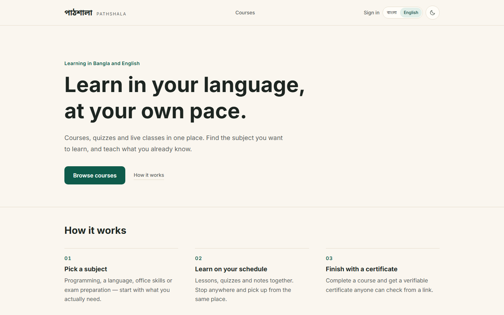
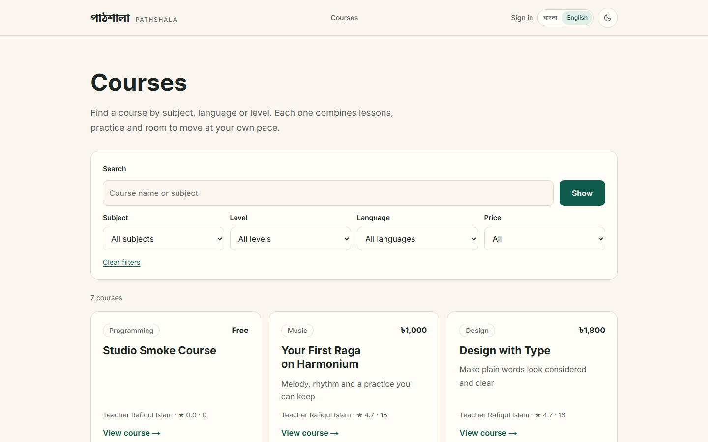
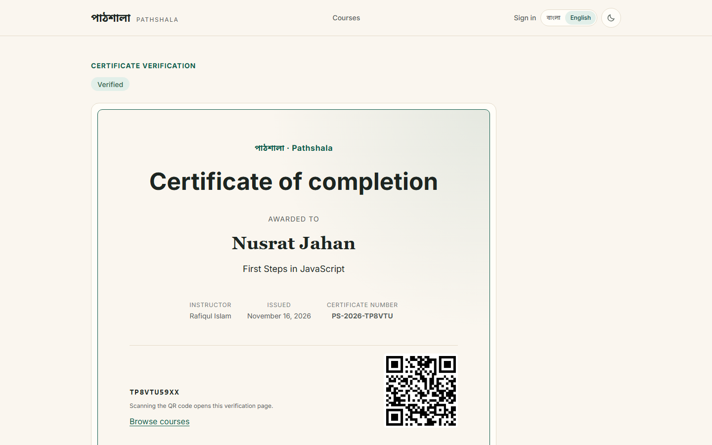
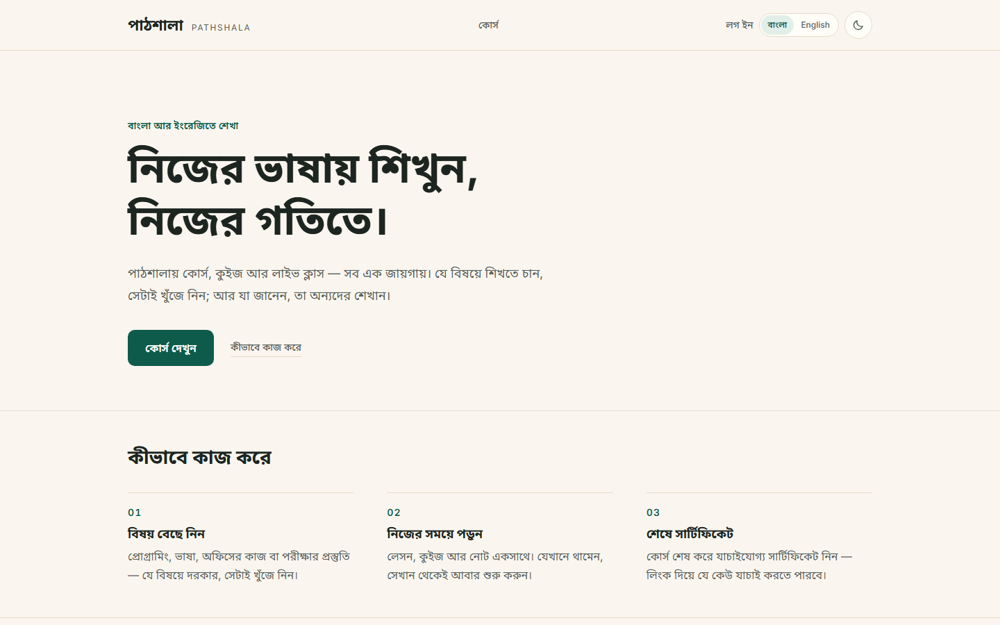

# Pathshala

A bilingual (বাংলা / English) course marketplace where instructors publish lessons, quizzes
and live classes, and learners enrol, track progress, pay in test mode and earn a certificate
anyone can verify.

**Live API:** [pathshala-api-lake.vercel.app/health](https://pathshala-api-lake.vercel.app/health) ·
**Repository:** [github.com/ibrahimSumon47/Pathshala](https://github.com/ibrahimSumon47/Pathshala)

The web app is built and passing its full production-build suite locally. Its public
deployment waits on the owner's free MongoDB Atlas URI; see [docs/DEPLOY.md](docs/DEPLOY.md)
and [docs/OWNER_TODO.md](docs/OWNER_TODO.md). No demo URL is claimed before it works.



## What it does

- **Bilingual by default.** Bangla lives at `/`, English at `/en`; copy, course titles,
  categories and certificates are translated rather than machine-switched.
- **Teaching studio.** Instructors create courses, sections and lessons, sanitize lesson
  HTML, add https attachments, build three quiz question types, schedule Jitsi live rooms
  and read per-course revenue, sales, completion and attendance.
- **Learning.** Free or paid enrolment, lesson completion with whole-number progress, quiz
  scoring on the server, private notes, lesson Q&A, reviews and a wishlist.
- **Payments in test mode.** A coupon-aware checkout with a Stripe test rail and PayBridge,
  a standalone sandbox gateway with signed webhooks, refunds, ledger splits and retryable
  deliveries. Fulfilment happens only after a verified webhook.
- **Live classes.** Generated Jitsi rooms, one attendance row per learner, `.ics` downloads
  and a min-heap reminder scheduler that delivers in-app notifications.
- **Trust.** One public certificate per completed course, a QR code and a verification page
  that needs no login; admins approve courses, change instructor access and export an audit
  CSV that cannot execute spreadsheet formulas.



## Architecture

```
apps/web        Next.js 16 · App Router · next-intl · Auth.js v5 · server actions
apps/api        NestJS · catalogue/health · Zod DTOs · one error envelope · rate limits
apps/paybridge  Next.js sandbox gateway · hashed merchant keys · hosted checkout · HMAC webhooks
packages/db     Mongoose models and services: catalogue, commerce, learning, live, certificates
packages/shared Money in integer paisa, progress math, a typed binary min-heap
packages/tokens CSS custom properties for a calm light/dark design system
docs            Decisions, handoff, security review, owner tasks and the feature gate
```

The web app owns authenticated writes through server actions. NestJS owns the public
catalogue and health endpoints, so a second client can reuse them without inventing a session
protocol. MongoDB is the only database; local development and tests use
`mongodb-memory-server`, and setting `MONGODB_URI` switches the same code to Atlas.

```
Browser ──► Next.js (session, server actions) ──► MongoDB
   │                │
   │                └──► Stripe test / PayBridge ──► signed webhook ──► order paid
   └──► NestJS /courses, /health ──► MongoDB
```

## Screenshots

| Certificate verification | Bangla landing |
| --- | --- |
|  |  |

## Stack

Next.js 16, React 19, TypeScript 6, Node 24, pnpm workspaces, MongoDB with Mongoose,
Auth.js v5 with bcrypt and optional Google, NestJS 11, Zod, Vitest, Playwright, axe-core and
Lighthouse. Styling is CSS Modules over design tokens; there is no UI framework to fight.
Fonts are Inter and Noto Sans Bengali, self-hosted by `next/font`.

## Run it locally

```bash
pnpm install
pnpm db:dev          # memory MongoDB on :27018, seeds and stays up
MONGODB_URI=mongodb://127.0.0.1:27018/pathshala pnpm --filter @pathshala/web exec next dev -p 59800
MONGODB_URI=mongodb://127.0.0.1:27018/pathshala pnpm --filter @pathshala/api dev
pnpm --filter @pathshala/paybridge dev   # gateway on :59801
```

Open `http://127.0.0.1:59800`. Use `127.0.0.1`, not `localhost`: session cookies are
host-scoped. Copy `apps/web/.env.example` to `apps/web/.env.local`; the demo accounts are
listed on the sign-in page and are off in production unless `DEMO_AUTH=true`.

Rerun the seed at any time with
`MONGODB_URI=mongodb://127.0.0.1:27018/pathshala pnpm db:seed`. The demo path is in
[docs/DEMO.md](docs/DEMO.md).

## Checks

```bash
pnpm lint && pnpm typecheck && pnpm test && pnpm build
pnpm test:e2e        # Playwright against the production build on :59802
pnpm test:a11y       # axe, included in test:e2e
pnpm audit           # production advisories
node scripts/check-done.mjs
```

Current results: **125 unit and integration tests** (12 tokens, 13 shared, 35 database,
48 web, 17 API), **8 Playwright flows**, **zero axe violations** on landing, catalogue,
sign-in and dashboard, and Lighthouse mobile **99/100/100/100** on landing and
**97/100/100/100** on the catalogue (performance/accessibility/best-practices/SEO).

## Security

Payments are test mode and every payment screen says so. Webhooks verify a raw-body
HMAC-SHA256 signature with a replay window before any order changes; replays are idempotent.
Private routes check the session and course access, admin mutations are audited, CSV cells
are quoted and formula-safe, and attachment metadata is allowlisted. The full review and
residual risks are in [docs/SECURITY.md](docs/SECURITY.md).

## Documentation

- [docs/DEMO.md](docs/DEMO.md) — a six-minute walkthrough.
- [docs/DEPLOY.md](docs/DEPLOY.md) — Atlas, Vercel, secrets and post-deploy checks.
- [docs/PROJECT_STATE.md](docs/PROJECT_STATE.md) — what exists and what is verified.
- [docs/DECISIONS.md](docs/DECISIONS.md) — why the stack looks like this.
- [docs/SECURITY.md](docs/SECURITY.md) — OWASP review.
- [docs/HANDOFF.md](docs/HANDOFF.md) — the next step for a new maintainer.
- [docs/OWNER_TODO.md](docs/OWNER_TODO.md) — the two owner-only console steps left.

## Limits

- Payments are a sandbox: no real card is charged. A live Stripe redirect needs the owner's
  sandbox keys; the signature path is proven with recorded fixtures.
- The deployed web origin and Atlas catalogue are pending `MONGODB_URI`; the API is live and
  honestly returns `503 database_unavailable` until then.
- Optional reminder email needs `RESEND_API_KEY` and a verified sender.
- In-process rate limits are per function instance, not global.
- The local memory database resets on restart; it is not production storage.
